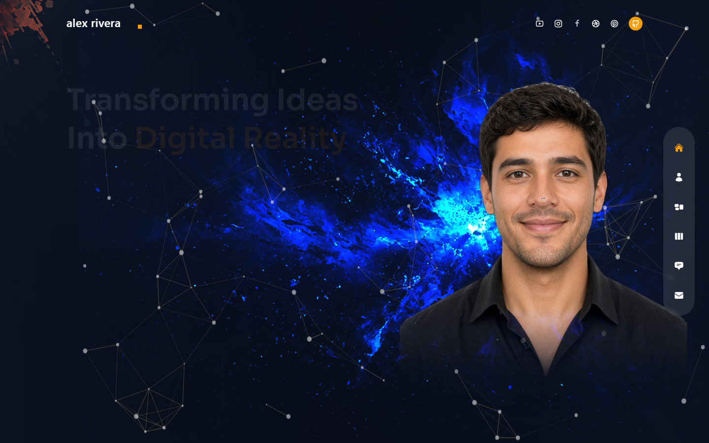
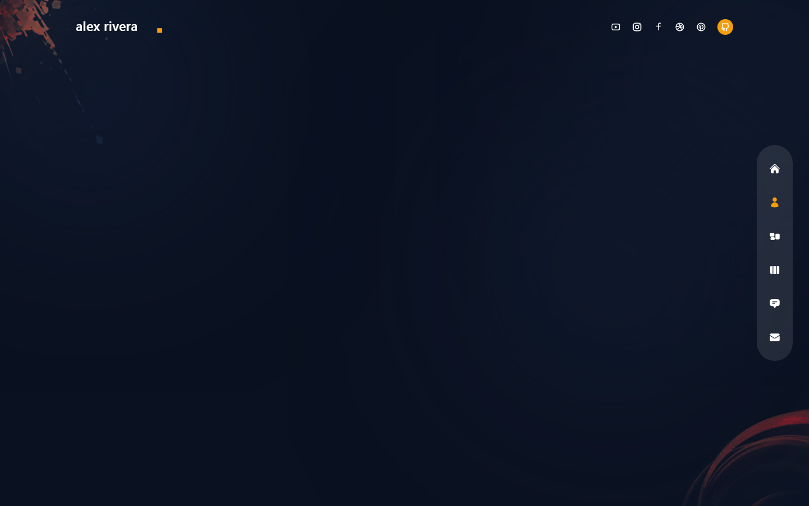
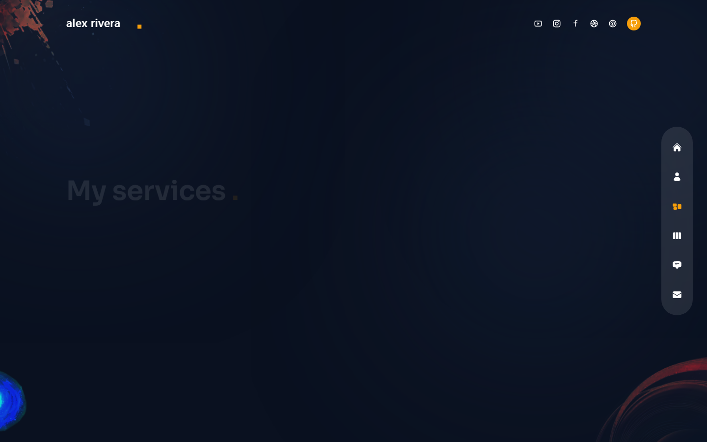
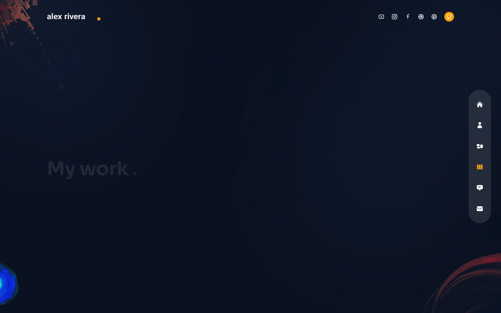
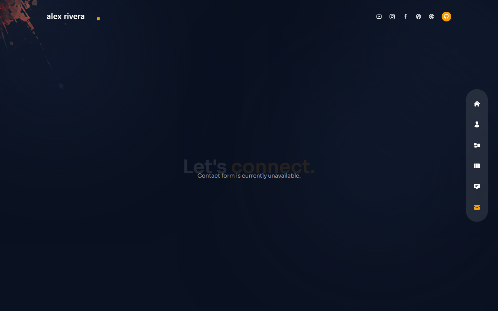

# Alex Rivera Portfolio

Personal portfolio for **Alex Rivera**, a full-stack web developer. Dark space-themed UI with Framer Motion transitions, particle effects, and a fixed viewport shell.

## Screenshots

| Home | About |
|------|-------|
|  |  |

| Services | Work |
|----------|------|
|  |  |



## Getting started

```bash
npm install --legacy-peer-deps
npm run dev
```

Open [http://localhost:3000](http://localhost:3000).

## License

Made by **Tahsan** · [CC BY 4.0](https://creativecommons.org/licenses/by/4.0/)
